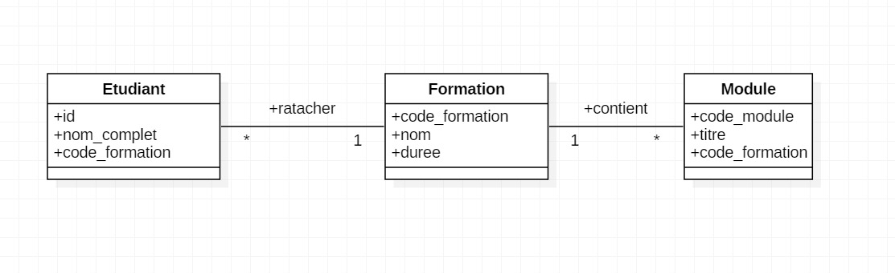
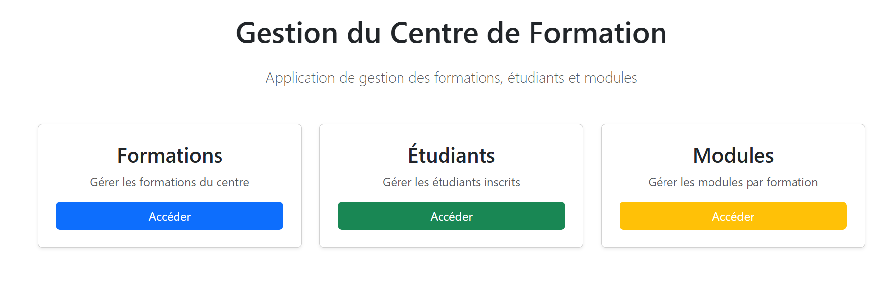
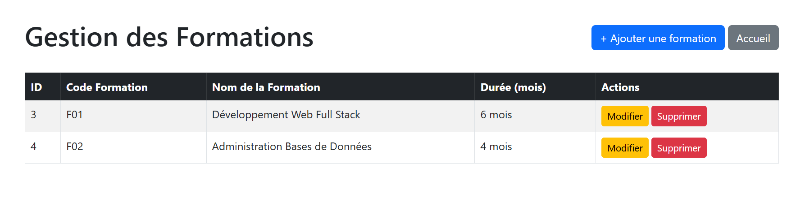
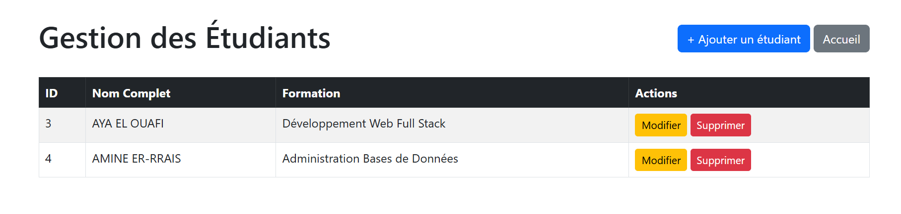
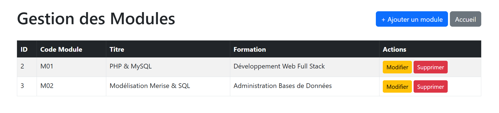

# TP7 - Application Web CRUD : Gestion d'un Centre de Formation

Application web dynamique développée en **PHP (PDO)**, **MySQL** et **Bootstrap 5** permettant la gestion complète (Création, Lecture, Mise à jour et Suppression) d'un centre de formation, incluant les **formations**, les **étudiants** et les **modules**.

---

##  Technologies utilisées

* **Langage Back-end :** PHP 8 (Architecture modulaire avec PDO)
* **Base de données :** MySQL / MariaDB
* **Front-end :** HTML5, Bootstrap 5.3
* **Serveur local :** XAMPP (Apache & MySQL)

---

##  Architecture du projet

    tp7-crud/
    ├── database/
    │   └── connexion.php       # Fichier de connexion à la base de données via PDO
    ├── formations/
    │   ├── index.php           # Liste des formations
    │   ├── create.php          # Ajout d'une nouvelle formation
    │   ├── edit.php            # Modification d'une formation
    │   └── delete.php          # Suppression d'une formation
    ├── etudiants/
    │   ├── index.php           # Liste des étudiants (avec jointure SQL)
    │   ├── create.php          # Inscription d'un étudiant
    │   ├── edit.php            # Modification d'un étudiant
    │   └── delete.php          # Suppression d'un étudiant
    ├── modules/
    │   ├── index.php           # Liste des modules (avec jointure SQL)
    │   ├── create.php          # Ajout d'un module
    │   ├── edit.php            # Modification d'un module
    │   └── delete.php          # Suppression d'un module
    ├── screenshots/            # Captures d'écran de l'application
    ├── database.sql            # Script SQL de création de la base de données
    ├── index.php               # Page d'accueil principale (Menu de navigation)
    └── README.md               # Documentation du projet

---

## Conception de la Base de Données (`tp7_crud`)

La base de données relationnelle `tp7_crud` est composée de trois tables liées par des clés étrangères avec contrainte d'intégrité référentielle (`ON DELETE CASCADE`) :

* **`formations`** (`id`, `code_formation`, `nom`, `duree`)
* **`etudiants`** (`id`, `nom_complet`, `code_formation` -> *FK vers `formations.id`*)
* **`modules`** (`id`, `code_module`, `titre`, `code_formation` -> *FK vers `formations.id`*)

### Diagramme de classes (UML)

---

##  Aperçu de l'application (Captures d'écran)

### 1. Page d'accueil
Interface centrale permettant d'accéder rapidement aux trois modules de gestion.

### 2. Gestion des Formations (CRUD)
Affichage, ajout, modification et suppression des formations du centre.

### 3. Gestion des Étudiants (CRUD + Jointure)
Affichage des étudiants avec le nom de leur formation associée via une requête `JOIN`.

### 4. Gestion des Modules (CRUD + Jointure)
Association des modules pédagogiques à chaque formation.

---

##  Guide d'installation et d'exécution

1. Copier le dossier `tp7-crud` dans le répertoire `htdocs` de **XAMPP** (ou `www` pour WampServer).
2. Démarrer les services **Apache** et **MySQL** depuis le panneau de contrôle XAMPP.
3. Ouvrir **phpMyAdmin** (`http://localhost/phpmyadmin`), aller dans l'onglet **Importer**, puis sélectionner le fichier **`database.sql`** situé à la racine du projet pour créer la base `tp7_crud` et ses tables.
4. Vérifier les paramètres de connexion dans `database/connexion.php` (`host: localhost`, `user: root`, `password: ""`).
5. Lancer l'application dans le navigateur via l'URL : `http://localhost/tp7-crud/`.